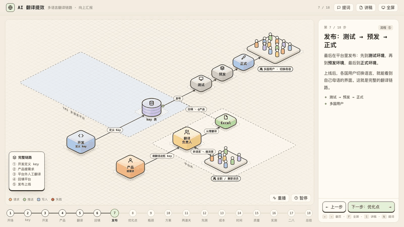

# iso-deck · Animated isometric diagrams

[中文](./README.md) · [Live examples](https://trade-offf.github.io/iso-deck/)

Turn a talk script into an animated isometric slide deck. The flow builds up page by page, the camera pushes in on whatever you are talking about, and every number on screen has a source. The output is **a single HTML file**: double-click to present, or send it to anyone.

It ships as an Agent Skill. Once installed, ask Cursor, Claude Code or Codex to "turn this script into an iso-deck". The agent cleans up the script, builds the diagram, screenshots and checks every page, and packages the result.



The bundled examples and docs are in Chinese. The engine UI also ships in English: set `lang: 'en'` on the deck.

## Install

Requires Node 18+. Screenshot checks and GIF export need Node 22+ and a local Chrome (or Edge / Chromium).

```bash
git clone https://github.com/Trade-Offf/iso-deck.git
node iso-deck/scripts/cli.mjs install            # into ~/.cursor, ~/.claude, ~/.codex, ~/.agents skills
```

Options: `--agent cursor`, `--dir <skills dir>`, `--link` (symlink for development). Or skip the clone: `npx github:Trade-Offf/iso-deck install`.

## CLI

```bash
node scripts/cli.mjs new my-deck --template report   # or: system
node scripts/cli.mjs validate my-deck   # references, facts ledger, camera values
node scripts/cli.mjs shoot my-deck      # screenshot every page and beat, flag overlaps → shots/index.html
node scripts/cli.mjs build my-deck      # single-file HTML → my-deck/dist/my-deck.html
node scripts/cli.mjs shoot my-deck --gif demo.gif --steps 2-5   # needs ffmpeg
node scripts/cli.mjs playbook my-deck --url http://127.0.0.1:4178/ -o playbook.json   # oil-studio recording script
```

While presenting: `→` / space to advance, `N` for speaker notes, `F` fullscreen, `#5` in the URL jumps to page 5, and `#5.2` jumps to page 5, beat 2.

## Ideas

- **One model, many pages.** `deck.model` holds coordinates once. Each page references entities by id and only overrides state (`dim`, `tags`, `heat`). The same id is the same thing, so transitions are automatic.
- **Beats inside a page.** `beats: [{ say, focus, zoom, card }]` pushes the camera onto the part being discussed, dims the rest, and returns to the overview at the end.
- **Facts ledger.** `facts: { key: { value, source } }`; pages use `{key}`. `validate` flags hard-coded numbers and bar charts whose values differ so much that the small bars vanish.
- **Self-checking visuals.** `shoot` drives headless Chrome over every page and beat, measures real element boxes, and reports text that covers other elements or leaves the frame.

## Credits

The idea of animated isometric diagrams comes from [designed-to-scale](https://designed-to-scale.vercel.app). The code is an independent zero-dependency rewrite.

MIT License
