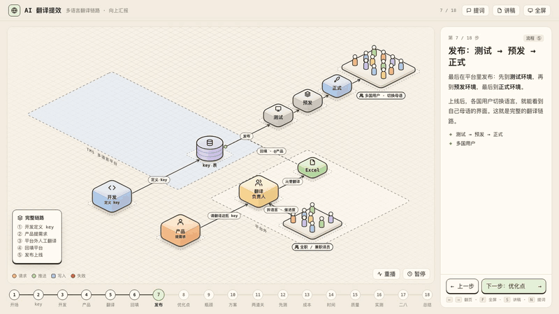

# iso-deck · 动态等距图解

[English](./README.en.md) · [在线示例](https://trade-offf.github.io/iso-deck/)

把一份口播稿做成会动的等距图解 PPT：流程一层层长出来，镜头推到正在讲的地方，每个数字都有出处。产物是**一个 HTML 文件**，双击就能演示，可以直接发给别人。

它是一个 Agent Skill：装好以后，在 Cursor、Claude Code、Codex 里说一句“把这份稿子做成动态图解”，Agent 会按流程整理稿子、画图、截图自查、打包。



## 适合做什么

| 场景 | 例子 |
| --- | --- |
| 向上汇报 | 把流程里的一段交给 AI：改了哪、省了多少、质量守不守得住（[示例](./examples/ai-translation)） |
| 讲解系统 / 新人入职 | 一次下单经过哪些服务、哪里会出问题（[示例](./examples/order-flow)） |
| 技术分享 | 一页推进一个概念，画面跟着长出来 |
| 录讲解视频 | 直接导出 GIF / MP4，或生成 oil-studio 录屏剧本 |

## 安装

需要 Node 18+。截图检查和录 GIF 需要 Node 22+ 和本机 Chrome（或 Edge、Chromium）。

```bash
git clone https://github.com/Trade-Offf/iso-deck.git
node iso-deck/scripts/cli.mjs install
```

默认装到本机已有的 `~/.cursor/skills/`、`~/.claude/skills/`、`~/.codex/skills/`、`~/.agents/skills/`。只装某一个：`--agent cursor`；装到别的目录：`--dir <skills 目录>`；开发时用软链接：`--link`。

不想 clone 也可以：`npx github:Trade-Offf/iso-deck install`。

## 用法

在 Agent 里：

> 用 iso-deck 把这份口播稿做成动态图解，讲给老板听，10 分钟左右。（附上稿子和数据来源）

Agent 会问清听众和时长，选模板，整理稿子，写数据，然后反复“检查 → 截图 → 修”，最后给你一个 HTML 文件。

也可以自己用命令行：

```bash
node scripts/cli.mjs new my-deck --template report --title "AI 翻译提效"   # 从模板新建
node scripts/cli.mjs validate my-deck     # 检查数据：引用、数字台账、镜头参数
node scripts/cli.mjs shoot my-deck        # 逐页截图，检查遮挡和出画 → my-deck/shots/index.html
node scripts/cli.mjs build my-deck        # 打包 → my-deck/dist/my-deck.html
```

演示时：`→` 或空格翻页，`N` 提词，`F` 全屏，`S` 隐藏讲稿区，地址栏 `#5` 跳到第 5 页。

## 和普通 PPT 有什么不同

**一张图贯穿始终。** 流程模型（`model`）只写一次坐标，每页只说“这一页高亮谁、加了什么”。同一个 id 就是同一个东西，翻页时平滑移动、变色、改状态，听众不会迷路。

```js
model: { entities: { dev: block(2, -30, { label: ['开发'] }), ... }, links: { ... } },
steps: [
  { title: '开发：定义 key', scene: { entities: ['dev', 'keys'], links: ['dk'] } },
  { title: '我们只动第 ③④ 步', scene: { entities: { dev: { dim: 1 }, lead: { tags: [...] } } } },
]
```

**镜头跟着讲的内容走。** 一页里要逐块讲的，写成页内节拍（`beats`）。每一拍推近到正在讲的那几块，其余变暗，讲完拉回全景。

```js
beats: [
  { say: '第一道：机器校验。', focus: ['ai', 'check'] },
  { say: '第二道：人工审核。', focus: ['keys', 'lead'] },
  { say: '两道关合起来：AI 起草，人做决定。' },
]
```

**数字有出处。** 页面上的数字一律写 `{key}`，值和出处放在台账（`facts`）里。改一个数只改一处，被追问时能答。`validate` 会找出所有硬写的数字。

```js
facts: { cost_old: { value: '¥1.2', source: '9 月账单，按实际用量折算，每百条' } },
title: '成本：每百条 {cost_old} → {cost_new}',
```

**画面自己会查。** `shoot` 用无头 Chrome 打开每一页、每一拍，截图，并检查文字有没有压住别的东西、有没有出画，生成一张总览页。

## 目录

```
SKILL.md        给 Agent 的主流程
references/     模板、整理稿子、字段手册、数字台账、布局、镜头、录视频
engine/         引擎，零依赖：iso-stage.js、iso-deck.js、iso.css
templates/      report（汇报）、system（系统讲解）
examples/       两个完整示例，数字都是示例数据
scripts/        命令行：new / validate / shoot / build / serve / playbook / install / gallery
docs/           GitHub Pages 示例画廊
tests/          node --test
```

## 开发

```bash
npm test                 # 单元测试
npm run validate         # 检查所有示例和模板
node scripts/cli.mjs gallery   # 重新生成 docs/（需要 Node 22+ 和 Chrome）
```

在仓库设置里打开 GitHub Pages，来源选 `main` 分支的 `/docs` 目录，示例画廊就能在线访问。

## 致谢

动态等距图解的想法来自 [designed-to-scale](https://designed-to-scale.vercel.app)。代码是独立重写的，零依赖。录屏剧本格式对接 oil-studio。

MIT License
