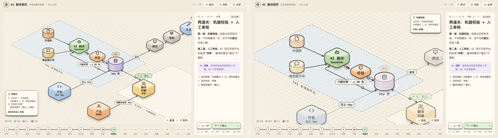
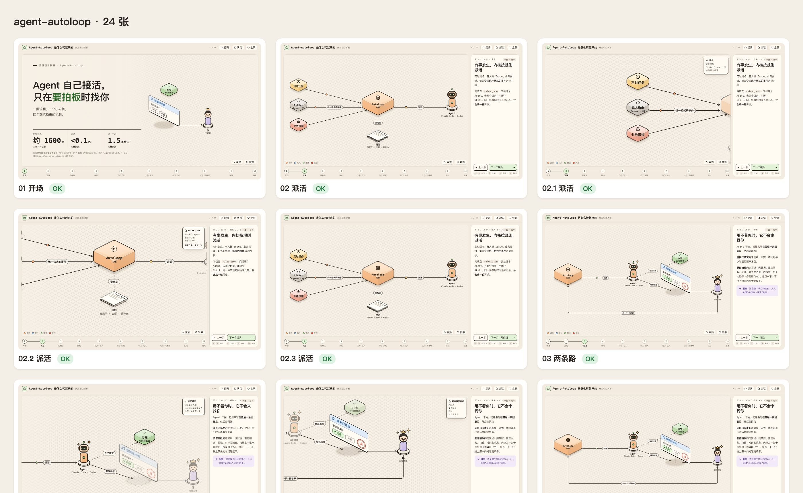
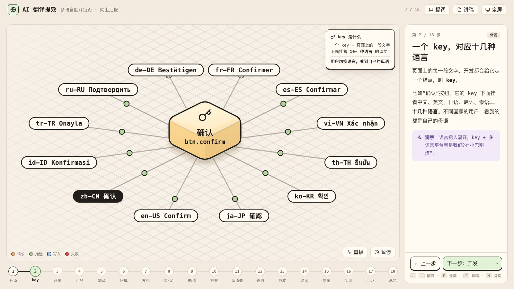
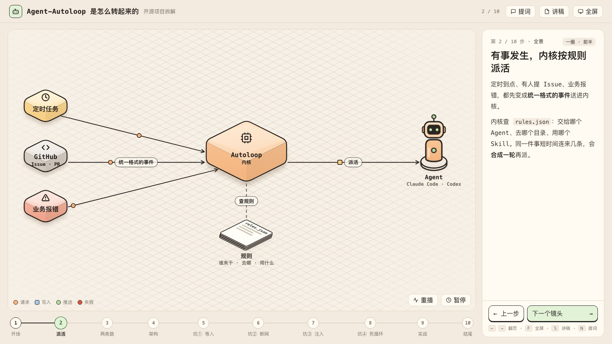
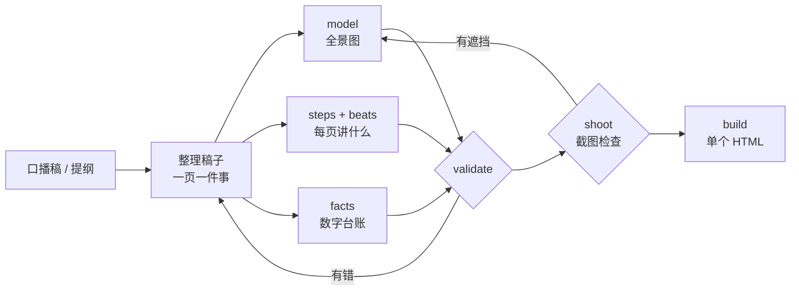

<div align="center">


# iso-deck

**把口播稿变成会动的等距图解。**

流程一层层长出来，镜头推到正在讲的地方，每个数字都有出处。<br>
产物是一个 HTML 文件，双击就能演示。

[](https://github.com/Trade-Offf/iso-deck/actions/workflows/ci.yml)
[](./LICENSE)
[](#安装)
[](./package.json)
[](./SKILL.md)

[**在线示例**](https://trade-offf.github.io/iso-deck/) · [快速开始](#快速开始) · [文档](#文档) · [English](./README.en.md)

<br>

<a href="https://trade-offf.github.io/iso-deck/ai-translation.html"></a>

</div>

<br>

## 为什么做这个

一份汇报讲得清楚，靠的不是动画多，而是四件事：**讲的顺序对、画面不跳、数字可信、改起来快**。普通 PPT 每页都是一张新图，听众要重新找位置；数字散落在各页，被问“这个数怎么来的”时答不上来。

iso-deck 把这四件事变成了结构和检查：

- 一张全景图贯穿始终，每页只改其中一部分。
- 镜头跟着讲解推近、拉远。
- 数字统一放在台账里，每个都写明出处。
- 写完自动截图，检查文字有没有压住别的元素。

最初用于一次 AI 提效的向上汇报，同事看完都来问怎么做的，于是整理成了一个 Agent Skill。

## 特性

<table>
<tr>
<td width="50%" valign="top">

### 一张图讲到底

流程模型只写一次坐标，每页按 id 引用、只改状态。同一个 id 就是同一个东西：翻页时平滑移动、变色、长出新节点，听众不会迷路。

</td>
<td width="50%" valign="top">

### 镜头跟着讲解走

一页里要逐块讲的内容写成节拍（`beats`）。每一拍推近到正在讲的部分，其余变暗，讲完拉回全景。

</td>
</tr>
<tr>
<td colspan="2"></td>
</tr>
<tr>
<td width="50%" valign="top">

### 数字有出处

页面里一律写 `{cost_old}`，值和出处放在 `facts`。改一个数只改一处。`validate` 会找出所有硬写的数字，也会提醒“差距太大、小柱子会被压扁”的图表。

</td>
<td width="50%" valign="top">

### 画面自己会查

`shoot` 用无头 Chrome 打开每一页、每一拍，截图并检查文字遮挡和出画，生成一张总览页。Agent 改完布局就重拍，直到没有问题。

</td>
</tr>
<tr>
<td colspan="2"></td>
</tr>
</table>

此外：

- **有人味的元素**：人物和机器人会做表情（干活、睡着、疑问、开心），还有审批卡片、对话气泡、一叠文档。一眼分清谁是人、谁是系统、什么时候要找人。
- **单文件交付**：`build` 把引擎和样式内联进一个 HTML，不需要服务器，可以直接发微信或邮件。
- **零依赖**：引擎和脚本都只用浏览器和 Node 自带的能力，`npm install` 都不用。
- **能录视频**：直接导出 GIF / MP4，或生成 oil-studio 录屏剧本，口播稿直接当字幕。

## 快速开始

### 安装

```bash
git clone https://github.com/Trade-Offf/iso-deck.git
node iso-deck/scripts/cli.mjs install
```

会装到本机已有的 `~/.cursor`、`~/.claude`、`~/.codex`、`~/.agents` 下的 `skills/iso-deck`。也可以不 clone：`npx github:Trade-Offf/iso-deck install`。

> 需要 Node 18+。截图检查和录 GIF 需要 Node 22+ 和本机 Chrome（或 Edge、Chromium）。

### 在 Agent 里用

```text
用 iso-deck 把这份口播稿做成动态图解，讲给老板听，10 分钟左右。
（附上稿子和数据来源）
```

Agent 会问清听众和时长，选模板，整理稿子，写模型和台账，反复“检查 → 截图 → 修”，最后交给你一个 HTML 文件。

### 或者自己动手

```bash
node scripts/cli.mjs new my-deck --template report --title "AI 翻译提效"
node scripts/cli.mjs validate my-deck     # 数据检查
node scripts/cli.mjs shoot my-deck        # 截图 + 遮挡检查 → my-deck/shots/index.html
node scripts/cli.mjs build my-deck        # 打包 → my-deck/dist/my-deck.html
```

演示时：<kbd>→</kbd> / <kbd>Space</kbd> 翻页，<kbd>N</kbd> 提词，<kbd>F</kbd> 全屏，<kbd>S</kbd> 隐藏讲稿区；地址栏 `#5.2` 跳到第 5 页第 2 拍。

## 示例

<table>
<tr>
<td width="50%" align="center">
<a href="https://trade-offf.github.io/iso-deck/ai-translation.html"></a>
<br><b>AI 翻译提效</b> · 向上汇报 · 18 页<br>
<sub>把流程里的一段交给 AI：改了哪、省了多少、质量守不守得住</sub><br>
<a href="https://trade-offf.github.io/iso-deck/ai-translation.html">在线演示</a> · <a href="./examples/ai-translation/index.html">源码</a>
</td>
<td width="50%" align="center">
<a href="https://trade-offf.github.io/iso-deck/agent-autoloop.html"></a>
<br><b>Agent-Autoloop 是怎么转起来的</b> · 项目拆解 · 10 页<br>
<sub>一圈流程、一个小内核、四个踩坑换来的机制</sub><br>
<a href="https://trade-offf.github.io/iso-deck/agent-autoloop.html">在线演示</a> · <a href="./examples/agent-autoloop/index.html">源码</a>
</td>
</tr>
</table>

「AI 翻译提效」里的数字都是示例数据。「Agent-Autoloop」整理自 [数字生命卡兹克](https://x.com/Khazix0918) 的 X 长文[《开源我这折腾了1年的「Agent自动化系统」》](https://x.com/Khazix0918/status/2117776745688646139)，项目 [KKKKhazix/agent-autoloop](https://github.com/KKKKhazix/agent-autoloop) 以 MIT 开源；图解为二次整理，观点和数据归原作者。

## 工作原理



一页的写法：

```js
{
  title: '瓶颈：一个人对接所有项目',
  notes: ['为什么慢？关键在翻译负责人这一个节点。'],                                   // 提词，按 N 显示
  scene: {
    entities: { dev: { dim: 1 }, lead: { tags: [{ text: '排队中', tone: 'red' }] }, excel: true },
    links: ['ls', 'le'],                                    // 按 id 引用模型
    flows: [{ route: ['ls'], rate: 2, kind: 'msg', bounce: true }],
  },
  beats: [
    { say: '瓶颈在翻译负责人这一个节点。', focus: ['lead'] },
    { say: '这就是排队的原因。' },                           // 不带 focus：回到全景
  ],
}
```

## 命令

| 命令 | 作用 |
| --- | --- |
| `new <目录> --template report\|system` | 从模板新建 deck，自带引擎 |
| `validate <deck>` | 检查引用、数字台账、镜头参数、图表比例 |
| `shoot <deck>` | 逐页逐拍截图，检查遮挡和出画；`--gif` / `--mp4` 录动图 |
| `build <deck>` | 打包成单个 HTML |
| `serve <目录>` | 本地 http 服务（录屏用） |
| `playbook <deck> --url <http 地址>` | 生成 oil-studio 录屏剧本 |
| `install` | 装成本机 Agent 的 Skill |

所有命令都是 `node scripts/cli.mjs <命令>`，不带参数可以看详细用法。

## 文档

| 文档 | 内容 |
| --- | --- |
| [SKILL.md](./SKILL.md) | 给 Agent 的主流程 |
| [templates.md](./references/templates.md) | 汇报、系统讲解、技术分享分别按什么顺序讲 |
| [script-cleanup.md](./references/script-cleanup.md) | 怎么把录音转写整理成一页一件事 |
| [scene-api.md](./references/scene-api.md) | 字段手册：实体、连线、数据包、信息卡、节拍 |
| [facts.md](./references/facts.md) | 数字台账，以及什么时候别按比例画 |
| [layout-rules.md](./references/layout-rules.md) | 坐标怎么排、遮挡怎么改、截图报告怎么看 |
| [camera-judgment.md](./references/camera-judgment.md) | 什么时候推近、推多少 |
| [video.md](./references/video.md) | 导出 GIF / MP4，用 oil-studio 录讲解视频 |

## 常见问题

<details>
<summary><b>打开需要启动服务吗？</b></summary>

不需要。`build` 出来的是单个 HTML，双击就能打开，也能直接发给别人。只有用 oil-studio 录屏时才需要 `serve`，因为它只接受 http 地址。

</details>

<details>
<summary><b>能导出成 PowerPoint 吗？</b></summary>

不能。动画、镜头和数据包都依赖浏览器实时渲染。需要放进 PPT 时，导出 MP4 插进去：`shoot <deck> --mp4 out.mp4`。

</details>

<details>
<summary><b>不用 Agent 能用吗？</b></summary>

能。从模板新建后照着改 `model`、`facts`、`steps`，字段见 [scene-api.md](./references/scene-api.md)，命令行负责检查和打包。Agent 的价值在于整理稿子、排布局，以及截图后自己修。

</details>

<details>
<summary><b>投屏和翻页笔支持吗？</b></summary>

画布固定 1600×900，会按窗口等比缩放。翻页笔发送的 PageDown 和方向键都能翻页。

</details>

<details>
<summary><b>英文界面？</b></summary>

在 deck 上写 `lang: 'en'`，界面文字会换成英文；单个文字可以用 `ui: { ... }` 覆盖。

</details>

## 开发

```bash
npm test                         # 单元测试
npm run validate                 # 检查所有示例和模板
node scripts/cli.mjs gallery     # 重新生成 docs/ 在线画廊（需要 Node 22+ 和 Chrome）
```

欢迎提 Issue 和 PR，尤其是新的模板和示例。提交前请跑一遍 `npm test` 和 `npm run validate`。

## 致谢

动态等距图解的想法来自 [designed-to-scale](https://designed-to-scale.vercel.app)。代码是独立重写的，零依赖。

## License

[MIT](./LICENSE)
